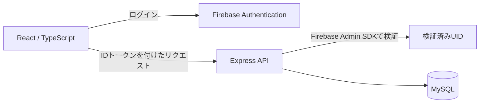

# PlayLoop

レトロゲームの商品検索・出品・購入手続きと、ゲームについて交流する掲示板をまとめた学習用Webアプリです。React / TypeScriptの画面とExpressのAPIを組み合わせています。

共同制作した作品を、就職活動でコードを確認していただくために整理したリポジトリです。以下は作品全体の機能と構成を説明しています。

**主な機能**

| 機能 | 内容 | 主なコード |
| --- | --- | --- |
| 商品検索 | キーワード・カテゴリー・状態・プラットフォーム・価格帯による絞り込み、並べ替え | [Search.tsx](PlayLoop/src/components/Search/Search.tsx) |
| 出品管理 | 商品の登録、確認、編集、取り消し | [Listing](PlayLoop/src/components/Listing/) |
| 購入手続き | 商品詳細、配送先入力、支払方法の選択、購入確認 | [Purchase](PlayLoop/src/components/Purchase/) |
| マイページ | 出品中・売却済みの商品、購入履歴、お気に入りの表示 | [Mypage.tsx](PlayLoop/src/components/Mypage/Mypage.tsx) |
| 掲示板 | スレッド作成、コメント、引用、いいね | [Forum](PlayLoop/src/components/Forum/) |
| アカウント | Firebase Authenticationによる登録・ログイン、表示名の変更 | [Account](PlayLoop/src/components/Account/) |

決済はデモです。実際の課金やカード情報の入力・保存は行いません。

**使用技術**

| 担当する処理 | 技術 |
| --- | --- |
| 画面・画面遷移 | React 19、TypeScript、React Router |
| 開発・ビルド | Vite、ESLint |
| API | Node.js、Express 5 |
| データアクセス | MySQL、mysql2 |
| 認証 | Firebase Authentication、Firebase Admin SDK |
| 画像アップロード | Multer |
| 自動テスト | Node.js標準テストランナー |

ブラウザー側の認証情報をAPIへ渡し、サーバーで検証したUIDを使ってユーザーに紐づく処理を行います。



**コードで確認できる点**

- [API通信](PlayLoop/src/api.ts)：IDトークンを付ける処理を共通化し、送信先を設定したAPIに限定しています。
- [サーバーの認証処理](server/auth.cjs)：更新操作や個人の履歴取得に認証を求め、本人の更新ではUIDを照合します。本文に送られたUID・メールを本人確認の根拠にはしません。
- [API実装](server.js)：SQLのパラメーターに値を渡してDBへアクセスします。公開プロフィールの応答は表示名に限定しています。
- [環境設定](server/config.cjs)：接続情報を環境変数へ分離し、必須設定が未入力・ダミーの場合はバックエンドを起動しません。
- [テスト](test/)：認証・本人確認と、公開対象に秘密情報が混入した場合の検出を検証します。

**構成**

- `PlayLoop/`：React / Viteのフロントエンド
- `server.js`、`server/`：Express API、Firebase IDトークン検証、環境変数設定
- `.env.example`、`PlayLoop/.env.example`：ダミーの設定例
- `scripts/check-publication.cjs`：Gitの登録内容・履歴の確認
- `test/`：本人確認と公開対象チェックのテスト
- `docs/SETUP.md`：開発環境と検証コマンドの手順

**この版で確認できる範囲**

このリポジトリには実際の接続設定、利用者データ、画像、既存DBのダンプ、移行前のGit履歴を含めていません。画像がない箇所には「画像なし」を表示します。

| 確認方法 | できること |
| --- | --- |
| ソースを読む | 画面、API、認証処理、テストの実装を確認できます |
| 外部サービスを設定せずに起動する | 設定案内画面を確認できます。商品一覧やログイン画面の操作には設定が必要です |
| 自動検証を実行する | 実際のFirebase・MySQLへ接続せずに、テスト・静的解析・ビルド・公開対象チェックを実行できます |
| 自分の開発環境を設定する | Firebaseプロジェクト、MySQLのテーブル、架空のデータを別途用意して機能を確認します |

実サービスへ接続した一連の動作確認は未実施です。DBの初期化用SQLは収録していないため、リポジトリの取得だけで全機能が動作する構成ではありません。

**ローカルでの確認**

Node.js 22.13以降、npm、Gitが必要です。以下はリポジトリ直下で実行します。

```sh
npm ci
npm ci --prefix PlayLoop
npm run verify:publication
npm run dev --prefix PlayLoop
```

開発サーバーが表示したURLをブラウザーで開いてください。環境設定がない場合は案内画面になります。設定方法と各コマンドは [開発環境の手順](docs/SETUP.md) にまとめています。

**設定・データの扱い**

- `.env` と `.env.*` はGit対象外です。例外はダミー値だけの `.env.example` です。
- `VITE_` 変数はブラウザーに配布されます。DBパスワード、秘密鍵、セッションsecretを設定しないでください。[Viteの環境変数](https://vite.dev/guide/env-and-mode)
- カード番号・CVC・名義・有効期限を入力・保存する機能はありません。支払方法名だけを保存します。
- 住所・ユーザー・投稿・商品の動作確認には架空データを使用してください。
- APIの更新操作・個人の履歴取得にはIDトークンが必要です。UIDやメールをリクエスト本文で指定しても、本人情報として採用しません。
- 画像アップロード機能は残していますが、画像ファイル自体はGit対象外とし、強制追加された場合も公開対象チェックで検出します。

**公開前の確認**

`npm run verify:publication` は、テスト → ESLint → TypeScript / Viteビルド → 公開対象チェックの順で実行します。

公開対象チェックは、編集中のファイル・Git対象になり得る新規ファイル・ステージ済みの内容・ローカルに取得済みの履歴・コミットメッセージを検査します。`.env.example` はダミー値だけを許可しています。

`npm ci` はこのリポジトリのGitフックを設定し、コミット・push前にも公開対象チェックを実行します。フックは回避可能で、自動検査も任意の氏名・住所や未知の秘密情報をすべて検出できるものではありません。公開時には差分とGitHub上の公開範囲も確認します。

公開確認の記録は [PUBLICATION_REVIEW.md](PUBLICATION_REVIEW.md) にあります。公開・デプロイは自動化していません。コードの公開と、実ユーザーを受け入れるサービスの運用は別に検証してください。
